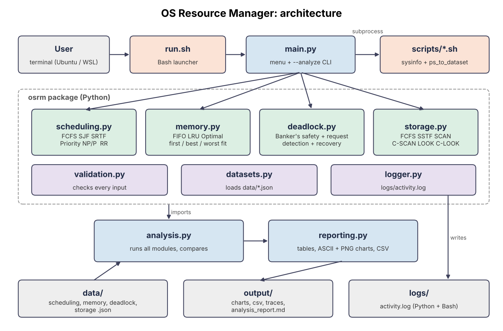
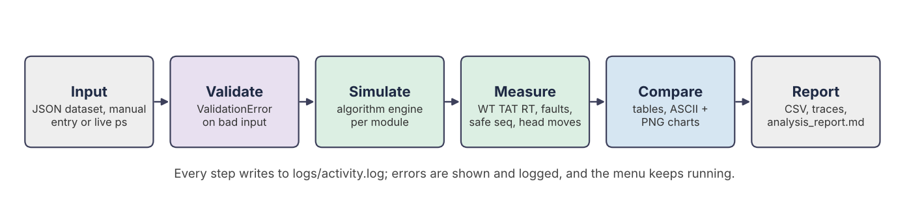

# OS Resource Manager: system design

**Student:** Pranav Tripathi (2401010129), B.Tech CSE Semester 5, Section B, K.R. Mangalam University
**Course:** Operating Systems

## 1. Problem statement

An operating system manages four main resources: the CPU, main memory, the resources that processes lock (and can deadlock on), and the disk. The textbook algorithms for each are usually practised as separate small programs. This project puts them in **one integrated application** that

- runs every algorithm on the **same shared datasets**, so results can be compared fairly,
- accepts input from a dataset file, from the keyboard, or from **live processes of the Linux machine** (through Bash),
- measures each algorithm with standard OS metrics and presents tables, charts and written observations,
- validates every input, logs every action, and is covered by an automated test suite.

## 2. Modules

| Module | File | What it simulates | Main outputs |
|---|---|---|---|
| CPU scheduling | `osrm/scheduling.py` | FCFS, SJF, SRTF, Priority (non-preemptive and preemptive), Round Robin | Gantt chart, CT/TAT/WT/RT per process, averages, throughput, CPU utilisation, context switches |
| Memory | `osrm/memory.py` | Page replacement (FIFO, LRU, Optimal) and contiguous allocation (first, best, worst fit) | Faults, hits, fault rate, frame-by-frame trace, Belady check; block map, utilisation, waiting processes |
| Deadlock | `osrm/deadlock.py` | Banker's safety and resource-request algorithms, detection (multi-instance), recovery by termination | Need matrix, safe sequence, step trace, GRANTED / WAIT / UNSAFE / ERROR decision, deadlocked set |
| Storage | `osrm/storage.py` | Disk scheduling: FCFS, SSTF, SCAN, C-SCAN, LOOK, C-LOOK | Service order, total and average head movement, head-path chart |
| Reporting | `osrm/reporting.py`, `osrm/analysis.py` | Runs all modules on the shared datasets and compares them | Text tables, ASCII bars, PNG charts, CSV files, traces, `analysis_report.md` |
| Support | `osrm/validation.py`, `osrm/datasets.py`, `osrm/logger.py` | Input checking, dataset loading, activity logging | `ValidationError` messages, `logs/activity.log` |
| Interface | `main.py`, `run.sh` | Menu flow and command-line entry; Bash launcher | Interactive menu, `--analyze` batch mode |
| System (Bash) | `scripts/sysinfo.sh`, `scripts/ps_to_dataset.sh` | Reads the real machine with `ps`, `free`, `df`, `nproc` | `output/system_snapshot.txt`, `data/live_processes.json` |

## 3. Architecture



The design has three layers:

1. **Interface layer** (`run.sh`, `main.py`): the only part that talks to the user. `run.sh` is the single entry point; it checks the environment, starts the menu or the batch analysis, runs the tests and calls the Bash scripts. `main.py` holds the menu and calls the engines.
2. **Engine layer** (`scheduling`, `memory`, `deadlock`, `storage`): pure functions and small classes. They never print or ask for input; they take Python lists and return result objects. This is what makes them reusable by the menu, the analysis and the tests alike.
3. **Service layer** (`validation`, `datasets`, `logger`, `reporting`, `analysis`): shared helpers used by every engine.

Python and Bash are joined in both directions: `run.sh` calls Python, and `main.py` calls the Bash scripts with `subprocess` (menu options 1 → "live processes" and 6 → "system snapshot"). Both write to the same log file.

## 4. Workflow (input → output)



1. **Input**: a workload is read from `data/*.json`, typed in at the menu, or produced from `ps` by `ps_to_dataset.sh`.
2. **Validate**: `validation.py` checks types, ranges and shapes. Bad input raises `ValidationError` with a clear message; the menu shows it, logs it and asks again.
3. **Simulate**: the engine runs the chosen algorithm (or all of them).
4. **Measure**: the result object computes the metrics.
5. **Compare**: `reporting.py` builds text tables, ASCII bar charts and (when matplotlib is installed) PNG charts.
6. **Report**: `analysis.py` writes CSV files, step-by-step traces and `output/analysis_report.md`, including automatic observations.

Menu flow:

```
Main menu
 1 CPU scheduling      -> choose workload (mixed / convoy / manual / live) -> one algorithm | compare all | RR quantum sweep
 2 Memory management   -> page replacement | contiguous allocation
 3 Deadlock handling   -> Banker's safety | resource request | detection + recovery
 4 Disk scheduling     -> standard / heavy / manual -> one algorithm | compare all
 5 Full analysis       -> everything above on the shared datasets, saved to output/
 6 System snapshot     -> runs scripts/sysinfo.sh
 7 View activity log
 0 Exit                ('b' goes back from any sub-menu)
```

## 5. Data design

### 5.1 Shared datasets (`data/`)

| File | Contents |
|---|---|
| `scheduling.json` | `workloads.mixed` (6 processes, staggered arrivals), `workloads.convoy` (1 long + 3 short jobs at time 0), `quantum` 3, `quantum_sweep` [1 … 10] |
| `memory.json` | 20-reference string (7 0 1 2 0 3 0 4 2 3 0 3 2 1 2 0 1 7 0 1), 3 frames, frame sweep 1–7, Belady string 1 2 3 4 1 2 5 1 2 3 4 5, blocks [100 500 200 300 600] KB, requests 212 417 112 426 KB |
| `deadlock.json` | Banker's state (5 processes, resources A B C, Available 3 3 2), four requests in order, two detection cases |
| `storage.json` | 200-cylinder disk; `standard` (head 53, up, 8 requests), `heavy` (head 100, down, 20 requests) |

Example process record:

```json
{"pid": "P1", "arrival": 0, "burst": 8, "priority": 3}
```

Priority rule used everywhere: **smaller number = higher priority**. Ties go to the earlier arrival, then to input order.

### 5.2 In-memory data structures

| Structure | Where | Purpose |
|---|---|---|
| `Process` dataclass (pid, arrival, burst, priority) | scheduling | one process |
| Ready queue: list filtered by arrival + `min()` with a key tuple | SJF / SRTF / Priority | picks the next process in O(n) |
| `collections.deque` | Round Robin | ready queue; new arrivals are added before the preempted process |
| Gantt list of `[label, start, end]` | scheduling | timeline; adjacent slots of the same process are merged; `IDLE` for idle CPU |
| `ScheduleResult` | scheduling | per-process rows + metrics dict |
| Frame list + loaded-time dict / last-used dict / future-use scan | FIFO / LRU / Optimal | victim selection |
| `PagingResult` (faults, hits, trace) | memory | trace has one dict per reference (page, frames, hit/fault, victim) |
| Remaining-size list of blocks | contiguous allocation | updated as processes are placed |
| `BankerState` (allocation, maximum, available, names) + `need` property | deadlock | validated on creation (Allocation ≤ Maximum) |
| Work vector and Finish list | safety and detection | the standard textbook algorithm |
| `DiskResult` (path, moves, total) | storage | every head position and each move's distance |

### 5.3 Output files

```
output/
  analysis_report.md        full report with tables, charts and observations
  system_snapshot.txt       host machine snapshot (Bash)
  test_results.txt          test suite output
  charts/*.png              labelled charts (bar, line, Gantt, head path)
  csv/*.csv                 every comparison table, for Excel
  traces/*.txt              step-by-step traces per module, console output, replayed sample sessions
logs/activity.log           every action from Python and Bash
```

## 6. Implementation plan (followed)

| Step | Work | Result |
|---|---|---|
| 1 | Fix the shared rules (priority order, RR queue rule, C-SCAN jump) and the JSON formats | `data/*.json`, this document |
| 2 | Build validation and logging first, so every engine uses them | `validation.py`, `logger.py` |
| 3 | Build the four engines as pure functions; check each against hand-solved textbook answers | `scheduling.py`, `memory.py`, `deadlock.py`, `storage.py` |
| 4 | Build reporting and the analysis runner on the shared datasets | `reporting.py`, `analysis.py` |
| 5 | Build the menu and the Bash layer (launcher, snapshot, live-process import) | `main.py`, `run.sh`, `scripts/` |
| 6 | Write unit, boundary, invalid-input, random and integration tests | `tests/` (53 tests), `samples/` (5 sample sessions) |
| 7 | Run everything on Ubuntu, capture screenshots, write README and report | `README.md`, report |

## 7. Design decisions

- **Engines never print.** They return objects, so the same code serves the menu, the batch analysis and the tests.
- **Clock starts at the first arrival** and the CPU is shown as `IDLE` when no process is ready, so utilisation is correct for workloads with gaps.
- **Round Robin**: a process that arrives during a time slice joins the queue *before* the process that was just preempted (the rule used in class).
- **C-SCAN / C-LOOK** count the return jump in the head movement by default (as in the class slides); `count_jump=False` leaves it out.
- **Banker's requests** in the dataset are applied one after another, so a granted request changes the state for the next one.
- **Charts are optional.** If matplotlib is missing, the program still runs and prints ASCII charts; PNG charts are skipped with a message.
